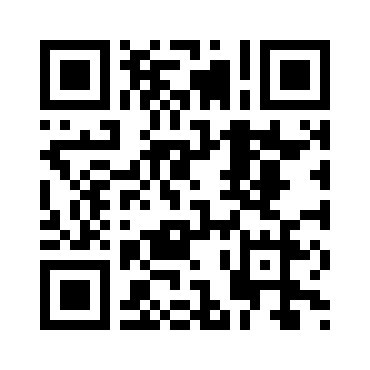
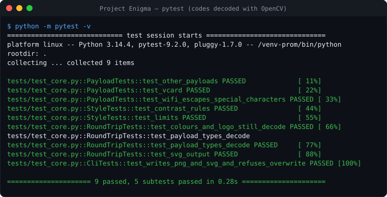

# 🧩 Project Enigma

[](https://github.com/fas0ftware/Project-Enigma/actions/workflows/ci.yml)


A QR code generator by **FA Software**: a dark CustomTkinter desktop app plus a command-line tool.

<p align="center"> </p>

## Features

- Payload types: text/URL, **Wi-Fi** (with correct escaping of `; , : " \`), **vCard contact**, e-mail, SMS, phone, location.
- Custom colours with a **contrast check** (unreadable or inverted codes are refused), error-correction level, size, border.
- **Centre logo** (automatically uses error level H), **PNG and SVG** export, save dialog instead of a fixed file name.

## Usage

```bash
pip install -r requirements.txt
python main.py                                    # desktop app
python cli.py text "https://example.com" -o site.png
python cli.py wifi --ssid "Home" --password "s3cret" -o wifi.png --fg "#1e3a8a" --bg "#fefce8"
python cli.py contact --name "Ada Lovelace" --phone "+44 20 7946 0000" -o ada.svg
```

## Tests

Every generated code (including coloured codes and codes with a logo) is **decoded again with OpenCV** and must return the exact input.

```bash
pip install -r requirements-dev.txt && python -m pytest -v
```



## Changelog

- **2.0.0** – Core module and CLI, Wi-Fi/vCard/e-mail/SMS/phone/geo payloads, colours with contrast check, logo, SVG, save dialog, Pillow 13 (12.1 had known advisories), decode-verified tests, CI.
- **1.0.0** – Text to QR, fixed file name.

---

Part of the **FA Software** projects. Licensed under the [MIT License](LICENSE).
